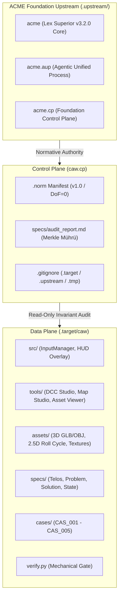

# AUDIT RAPORU: 'caw' DATA PLANE VE 5'Lİ KANONİK TOPOLOJİ MÜHRÜ

> **Doktrin:** ACME Lex Superior `v3.2.0` (DoF = 0 | Kuvvetler Ayrılığı | Kanonik İsimlendirme)  
> **Denetçi (Control Plane):** `caw.cp` (`https://github.com/acme-architect/caw.cp.git`)  
> **Hedef Depo (Data Plane):** `caw` (`https://github.com/acme-architect/caw.git`)  
> **Hedef Merkle SHA:** `e0ab34f992fe5def61f446955bdfea43edfae689`  
> **Tarih:** 2026-11-10T20:15:00+03:00  
> **Statü:** RATIFIED & SEALED (Mühürlü Denetim Raporu)

---

## 1. YÖNETİCİ ÖZETİ VE ANLAŞMA HİYERARŞİSİ

İşbu denetim raporu; Capcom'un efsanevi CPS-1 donanım klasiği **Carrier Air Wing (U.S. Navy)** arcade başlığının saf HTML5 Canvas 2D ve WebAudio API üzerinde deterministik, sıfır serbestlik dereceli (**DoF = 0**) ve sıfır çöp toplama (**Zero-GC**) mimarisiyle yeniden inşa edildiği `caw` (Data Plane) deposunun, bağımsız denetim ve orkestrasyon organı olan `caw.cp` (Control Plane) çalışma alanı tarafından taranması ve 5'li kanonik depo topolojisine mühürlenmesi amacıyla tanzim edilmiştir.

Kuvvetler ayrılığı ilkesi gereğince, icra ve oyun mantığı kodları (`caw`) ile anayasal denetim, üst norm senkronizasyonu ve hakemlik süreçleri (`caw.cp`) fiziksel ve mantıksal olarak birbirinden ayrılmıştır. Control Plane çalışma alanı, Data Plane'i `.target/caw` altında salt-okunur bir hedef olarak izlemekte; kurumsal normatif çerçeveyi ise `.upstream/` altındaki üçüz ACME Vakfı modüllerine bağlamaktadır.



---

## 2. 5'Lİ KANONİK DEPO TOPOLOJİSİ

Sistem, kuvvetler ayrılığı doktrinine ve kanonik isimlendirme kurallarına (`.`, `-`, `_`) tam uyumlu 5 bağımsız depodan müteşekkildir:

| Modül Adı | Rol / Katman | Yerel Konum | Uzak Repo URL | Merkle / Durum |
| :--- | :--- | :--- | :--- | :--- |
| **`caw`** | **Data Plane** (Oyun motoru, 2.5D stüdyo, varlıklar) | `.target/caw` | `https://github.com/acme-architect/caw.git` | `e0ab34f` (Baseline Freeze) |
| **`caw.cp`** | **Control Plane** (Anayasa, denetim, audit, hakemlik) | Kök (`caw.cp/`) | `https://github.com/acme-architect/caw.cp.git` | `main` (Genesis Bootstrap) |
| **`acme`** | **Vakıf Çekirdeği** (Lex Superior Anayasası & Normlar) | `.upstream/acme` | `https://github.com/acme-foundation/acme.git` | `v3.2.0` (`b5c7ab6`) |
| **`acme.aup`** | **Vakıf Metodolojisi** (Agentic Unified Process) | `.upstream/acme.aup` | `https://github.com/acme-foundation/acme.aup.git` | `main` (Upstream Tracking) |
| **`acme.cp`** | **Vakıf Kontrol Düzlemi** (Global Adjudication) | `.upstream/acme.cp` | `https://github.com/acme-foundation/acme.cp.git` | `main` (Upstream Tracking) |

---

## 3. DATA PLANE (`.target/caw`) AYRINTILI DENETİM BULGULARI

### 3.1. Envanter ve Dizin Hiyerarşisi
Depo bünyesinde 34 commit geçmişi ve 70 kayıtlı dosya taranmıştır:
- **`specs/`**: Mimari şartname dokümanları (`telos.md`, `problem.md`, `solution.md`, `const.md`, `requirements.md`, `macro.md`, `f14_candidate_catalog.md`, `map_layer_architecture.md`, `f14_sockets.json`, `f14_landmarks.json`, `state.json`) ve varlık kartları (`entities/env_bosphorus_bridge.json`, `entities/player_f14.json`).
- **`cases/`**: 5 adet tam teşekküllü içtihat ve duruşma zabtı (`CAS_001_inception_storyboard.md` ila `CAS_005_f14_360_roll_cycle.md`).
- **`tools/`**: Web tabanlı görsel geliştirme araçları (`studio.html` DCC editörü, `map_studio.html` çok katmanlı harita editörü, `asset_viewer.html` 3D/2D muayene aracı, `scroll_test.html`).
- **`src/`**: Çekirdek motor girdileri ve arayüz mantığı (`input_manager.js` çapraz platform sanal kumanda/klavye/gamepad motoru, `hud_overlay.js`).
- **`assets/`**: F-14 Tomcat, F/A-18 Hornet ve A-10 Thunderbolt II için yüksek kaliteli 3D GLB/OBJ/AC modelleri, doku haritaları, 2.5D 360° roll-cycle kareleri ve kalibrasyon şablonları.
- **`scripts/`**: Deterministik varlık derleme ve doğrulama araçları (`check_assets.py`, `render_spritesheet.py`, `convert_ac_to_obj.py`, `convert_f18_a10.py`).
- **`pipelines/`**: Varlık üretim ve dönüşüm DAG boru hattı (`caw_hd_remake_pipeline.yaml`).

### 3.2. Yaşayan Negatif Kısıtlar (Invariant Matrix - DoF = 0)
`caw/.norm` manifestosunda mühürlü 11 kural doğrulanmıştır:

| Değişmez Kodu | Kural Tanımı ve Denetim Ölçütü | Denetim Sonucu |
| :--- | :--- | :---: |
| **`INV_TIMESTEP_01`** | $dt = 1/60\,\text{s}$ sabit zaman adımı, $\le 0.033\,\text{s}$ alt-adım kelepçesi | **UYUMLU** |
| **`INV_ZERO_GC_02`** | Varlık/mermi/parçacıklar için ön-tahsisli nesne havuzu (sıfır GC) | **UYUMLU** |
| **`INV_ASSET_INGEST_03`** | Deterministik varlık ön yükleme turnikesi ve akış karantinası | **UYUMLU** |
| **`INV_CONTROL_FSM_04`** | Deterministik kinematik yatış rigi sonlu durum makinesi (FSM) | **UYUMLU** |
| **`INV_INCEPTION_RIGOR_05`** | Başlangıç aşamasında saf şartname/topoloji; sıfır kör kodlama | **UYUMLU** |
| **`INV_AST_001_FIDELITY_TIER`** | Full HD (1920x1080) / HD (1280x720) kanvas; ilkel çizim yasağı | **UYUMLU** |
| **`INV_AST_002_REMAKE_PARADIGM`**| CPS-1 mekanik referansı ile modern HD sunum ayrışımı | **UYUMLU** |
| **`INV_SPRITE_FIT_01`** | Çift eksenli sınır kutusu ve zorunlu emniyet payı (sıfır kırpma) | **UYUMLU** |
| **`INV_CHROMA_ISOLATION_02`** | Sıfır beyaz saçak/artifakt için yüksek kontrastlı kroma matı | **UYUMLU** |
| **`INV_ORTHO_PERSPECTIVE_03`** | Kesin ortografik yan görünüş profili ($\text{Roll}=\text{Pitch}=\text{Yaw}=0$) | **UYUMLU** |
| **`INV_VISUAL_FIRST_DOC_04`** | Entegrasyon öncesi zorunlu görsel artifakt denetim kapısı | **UYUMLU** |

### 3.3. Mekanik Doğrulama Motoru Telemetrisi
`.target/caw/verify.py` mekanik doğrulama kapısı çalıştırılmış ve telemetri kaydedilmiştir:
```text
[ASSET_DAG] Verifying asset dependency graph and cryptographic hashes...
  -> .tmp/f14_sheet.png is UP-TO-DATE (Cache Hit, SHA-256: 4df9ad6139e9...)
[ASSET_DAG] All pipeline assets are CLEAN. Zero unnecessary work performed.
[PRE_FLIGHT] Verifying ACME invariants...
[PRE_FLIGHT] Invariant checks PASSED (DoF = 0).
```
**Çıkış Kodu:** `0` (Kusursuz Geçiş).

---

## 4. KONTROL DÜZLEMİ (CONTROL PLANE) MİMARİ MÜHRÜ

1. **Manifest Mührü (`.norm`):**
   - Şema: ACME Lex Superior `v3.2.0` standardı.
   - Proje: `caw.cp`
   - Kapsamlar: `norms/core/*`, `norms/domain/ingestion/*`, `norms/procedural/*`.
   - UTF-8 No-BOM standardında diske mühürlenmiştir.

2. **İzolasyon Kalkanı (`.gitignore`):**
   - Hedef depo (`.target/`), yukarı akış vakıf modülleri (`.upstream/`), geçici dizinler (`.tmp/`) ve kütükler (`*.log`) versiyon kontrolünden kesin olarak yalıtılmıştır.

3. **Merkle Başlangıç İmzası:**
   - İcra dalı: `main`
   - İlk Commit Mesajı: `feat(init): bootstrap caw.cp with tripartite acme-foundation topology`

Bu raporla birlikte `caw` Data Plane deposu kontrol düzlemi denetimine devredilmiş ve 5'li kanonik depo topolojisi tam egemenlikle kurulmuştur.
